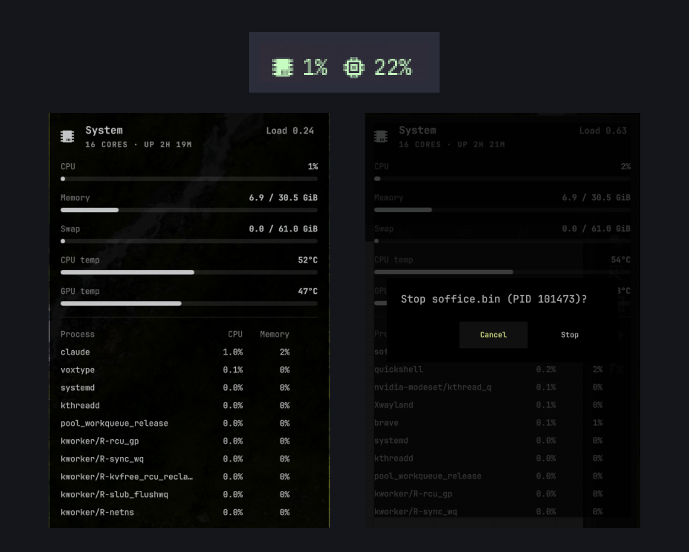

<div align="center">

# System Stats

**CPU, memory and temperature at a glance, right in your Omarchy bar.**


[Install](#install) · [Usage](#usage) · [Settings](#settings) · [IPC](#ipc) · [Privacy](#privacy) · [Tests](#tests)



</div>

---

An Omarchy shell bar widget that shows CPU and memory usage with their icons (or a single reading next to a chip icon), plus a panel of detailed readings.

## Features

| | |
|---|---|
| **Meters** | CPU, memory, swap, CPU temperature and GPU temperature, tinted as they run hot |
| **System info** | Load average, core count and uptime |
| **Process list** | Scrollable list of the 50 busiest processes, refreshed while the panel is open |
| **Safe process control** | Hover a process to stop it, with a confirmation step |

### Process control

- Stopping a process asks for confirmation first.
- While a process shuts down, its row shows how long it has been stopping and a **Force kill** button.
- Nothing is ever force-killed automatically.
- System processes and critical desktop processes such as Hyprland have no stop button.

## Usage

| Action | Result |
|---|---|
| **Click** | Opens the detail panel |
| **Right-click** | Cycles the bar reading |

The bar reading cycles in this order:

```
CPU + Memory  →  CPU  →  Memory  →  Temperature  →  Icon only
```

## Install

On a new Omarchy install:

```bash
omarchy plugin add https://github.com/Pieter-Uys/omarchy-system-monitor.git --enable
```

**Requirements:** only `bash`, `awk`, `top` (procps-ng) and `nproc` (coreutils), which every Omarchy install already has.

Choose the `right` section when asked, or move it later:

```bash
omarchy bar move io.github.pieter-uys.system-monitor --section right
```

<details>
<summary><b>Update or remove</b></summary>

<br>

Get later changes:

```bash
omarchy plugin update io.github.pieter-uys.system-monitor
```

Remove the plugin:

```bash
omarchy plugin remove io.github.pieter-uys.system-monitor
```

</details>

## Settings

| Key | Values | Default |
|---|---|---|
| `barLabel` | `CPU + Memory`, `CPU`, `Memory`, `Temperature`, `Icon only` | `CPU + Memory` |
| `refreshIntervalSec` | 1 to 60 | `3` |

## IPC

Control the widget from the command line or from keybindings:

```bash
omarchy-shell io.github.pieter-uys.system-monitor toggle
omarchy-shell io.github.pieter-uys.system-monitor cycleLabel
```

| Command | Description |
|---|---|
| `toggle` | Open or close the detail panel |
| `cycleLabel` | Advance to the next bar reading |

## Privacy

> Everything stays on your machine.

- All data is read locally by `bin/system-monitor` from `/proc`, `/sys/class/hwmon` and `top`.
- The plugin makes **no network requests** and writes no files of its own. Right-clicking saves your chosen bar reading in `shell.json` through the shell's normal widget settings.
- It only signals a process after you confirm, and only processes owned by your user.

## Tests

```bash
node --test ~/.config/omarchy/plugins/io.github.pieter-uys.system-monitor/tests/
```

## License

MIT. See [LICENSE](LICENSE).
